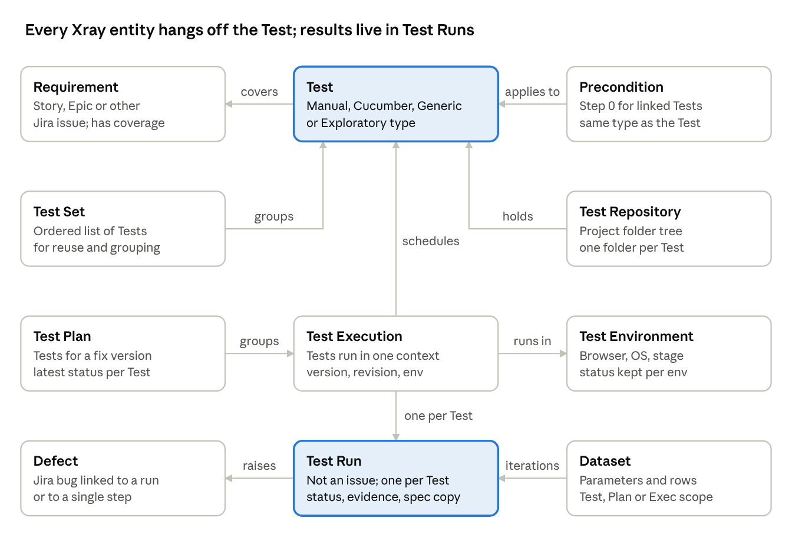

# Jira Xray: Test Management Model

> Exported copy. The live, editable version is [here](https://claude.ai/artifact/GJZck2K2u1rQrPGV4WW4QL).

Nov 7, 2026 · @Daniel Kolepp

## Problem statement

Xray exists to manage testing inside Jira, so tests, their results and the requirements they verify live in the same tool as the delivery work. It treats tests as Jira issues, which lets teams plan, link, report on and trace testing like any other work item.

The problems it targets:

- **Tests live apart from requirements.** Xray links Tests to requirement issues (e.g. Stories) and computes a coverage status on each requirement from the latest results ([Test](https://docs.getxray.app/space/XRAYCLOUD/44565156), [Features and benefits](https://www.getxray.app/blog/xray-test-management-for-jira/)).
- **Manual and automated results are scattered.** Manual runs and imported CI results feed the same model, so requirement status reflects both ([Working with Automated Tests](https://docs.getxray.app/space/XRAY/301503120/Working+with+Automated+Tests)).
- **Release questions need answers.** A Test Plan tracks the latest status of a set of Tests for a target version across many executions ([Test Plan](https://docs.getxray.app/space/XRAYCLOUD/44565153/Test+Plan)).
- **Developers and testers work in different tools.** Testing is "managed in the same way as any other issue type" such as Bug or Story ([Features and benefits](https://www.getxray.app/blog/xray-test-management-for-jira/)).

**Personas Xray assumes.** Its onboarding is split by role: Testers, QA Managers and Administrators each get a quick guide ([Getting started](https://docs.getxray.app/display/XRAY/Getting+started), [Quick Guide for QA Managers](https://docs.getxray.app/space/XRAYCLOUD/44566505/Quick+Guide+for+QA+Managers)). Developers appear as authors of automated tests that report into Xray through its APIs and CI plugins, not as a separate guided role. Not confirmed: a developer-specific quick guide.

## Intended use

Xray is meant to be the record of what was tested, against which requirement and version, with what result. Manual testers execute inside Jira; automated suites run in CI and push results in. Both land in the same Test Execution and Test Run model.

**Lifecycle.** Xray frames testing as planning, design, execution and reporting ([Features and benefits](https://www.getxray.app/blog/xray-test-management-for-jira/)).

| Step | Manual testing | Automated testing |
| --- | --- | --- |
| Design | Write a Manual Test (steps, data, expected result) in Jira | Write code; Xray holds a Generic or Cucumber Test as the reference |
| Plan | Group Tests in a Test Plan for a fix version | Same Test Plan; CI imports can target it |
| Execute | Open a Test Execution and run each Test Run step by step | CI runs the suite and produces a report |
| Record | Tester sets step and run statuses, attaches evidence, logs defects | Report is imported via REST or a CI plugin; Xray creates a Test Execution and Test Runs |
| Report | Coverage and status roll up to requirements and the Test Plan | Same; results count the same whether manual or automated |

Sources: [Execute Tests](https://docs.getxray.app/space/XRAY/160170368), [Test Execution](https://docs.getxray.app/space/XRAYCLOUD/44565117), [Import Execution Results - REST](https://docs.getxray.app/display/XRAYCLOUD/Import+Execution+Results+-+REST), [Working with Automated Tests](https://docs.getxray.app/space/XRAY/301503120/Working+with+Automated+Tests).

**Run statuses.** Xray Server/DC's built-in Test Run statuses are TODO, EXECUTING, PASS, FAIL and ABORTED; admins can add custom ones. A failed step fails the run ([Understanding coverage and status calculation](https://docs.getxray.app/display/XRAY/Understanding+coverage+and+the+calculation+of+Test+and+requirement+statuses)).

**Where it sits in delivery.** Requirements (Stories, Epics) are written in Jira. Tests are linked to them during refinement. CI imports results per build, tagged with a version, revision and Test Environment. Before release, the Test Plan and requirement coverage show what passed for that version ([Xray Maven plugin README](https://github.com/Xray-App/xray-maven-plugin)).

## Xray's model

The Test is the centre of Xray's model. Test, Precondition, Test Set, Test Plan and Test Execution are Jira issue types; the Test Run is an internal Xray record, not an issue ([ISTQB glossary vs Xray terminology](https://docs.getxray.app/space/XRAYCLOUD/44573128/ISTQB+glossary+vs+Xray+terminology), [Test Runs](https://docs.getxray.app/space/XRAYCLOUD/44565109/Test+Runs)).

Read it top down: a Test covers requirements and is grouped by Test Sets and folders; a Test Execution schedules Tests, creating one Test Run each; results, defects and dataset iterations attach to the Test Run.

| Entity | What Xray says it is | Jira issue? |
| --- | --- | --- |
| [Test](https://docs.getxray.app/space/XRAYCLOUD/44565156) | A test case. Default types: Manual (steps), Cucumber (Scenario or Scenario Outline), Generic (unstructured, usually an automated test) and Exploratory. Admins can add types. | Yes |
| [Precondition](https://docs.getxray.app/space/XRAYCLOUD/44565159/Precondition) | Initial conditions, "like defining step 0" for linked Tests. Types: Manual, Generic, Cucumber; must match the Test's kind. A Cucumber Precondition is a Gherkin Background. | Yes |
| [Test Set](https://docs.getxray.app/space/XRAY/301669340/Test+Sets+Overview) | An ordered, flat list of Tests for grouping and reuse. Adding it to a Test Execution copies its Tests; no link remains. | Yes |
| Test Repository | A per-project folder tree. A Test sits in exactly one folder but can be in many Test Sets ([Test](https://docs.getxray.app/space/XRAYCLOUD/44565156)). | No |
| [Test Plan](https://docs.getxray.app/space/XRAYCLOUD/44565153/Test+Plan) | A work item (not a document) listing the Tests to verify for a fix version, with their Test Executions and the latest status of each Test across iterations. | Yes |
| [Test Execution](https://docs.getxray.app/space/XRAYCLOUD/44565117) | Runs a chosen set of Tests in one context: version, revision, Test Environment. CI imports create these. | Yes |
| [Test Run](https://docs.getxray.app/space/XRAYCLOUD/44565109/Test+Runs) | One per Test per Test Execution. Holds status, step results, evidence, defects, and a copy of the Test spec and Preconditions as they were at execution time. | No |
| Test Environment | A label on a Test Execution (browser, OS, stage). Status can be analysed per environment; "All" passes only if every environment passed ([Coverage Analysis](https://docs.getxray.app/space/XRAYCLOUD/44565185/Coverage+Analysis)). | No |
| Requirement | Any Jira issue type configured as coverable (e.g. Story). Its coverage status comes from the latest Test Run of each linked Test ([status calculation](https://docs.getxray.app/display/XRAY/Understanding+coverage+and+the+calculation+of+Test+and+requirement+statuses)). | Yes |
| Defect | A Jira bug linked to a Test Run or to one step of it; can be linked through to the Test, Test Execution and requirement ([Reporting and Tracking Defects](https://docs.getxray.app/space/XRAYCLOUD/1027735560)). | Yes |
| [Dataset](https://docs.getxray.app/display/XRAYCLOUD/Parameterized+Tests) | Parameters and rows for a parameterized Test. Defined on the Test (default), overridden on a Test Plan or Test Execution; the closest wins. Each row is an iteration of the Test Run. Cloud limits: 1000 iterations, 20 parameters per dataset. | No |

Not confirmed: whether Test Repository folders and Test Environments carry other attributes beyond names.

## Use cases

Xray's use cases all come back to one question asked at different levels: has this requirement, plan or release been tested, and with what result? The table lists the ones its own documentation describes.

| Use case | How Xray does it | Who benefits |
| --- | --- | --- |
| Traceability and coverage per requirement | Tests link to requirements; each requirement is grouped as OK, NOK, NOT RUN, UNKNOWN or UNCOVERED for a version or Test Plan and environment ([Overall Requirement Coverage](https://docs.getxray.app/display/XRAY/Overall+Requirement+Coverage+Report)). The Traceability Report chains requirement, Tests, Test Runs and defects, up to 3 requirement levels (e.g. epic, story, sub-task). | Product owners, QA managers |
| Release readiness | Docs recommend the coverage report plus the Traceability Report for release status. Test Plans Report / Metrics show status counts and progress per plan and environment ([Quick Guide for QA Managers](https://docs.getxray.app/space/XRAY/160169985/Quick+Guide+for+QA+Managers)). Coverage per release depends on the Test Executions for that version, not on how many Test Plans exist. | Release managers, QA managers |
| Manual regression | Reuse Manual Tests via Test Sets and Test Plans; each cycle is a new Test Execution, and the Test Plan shows the latest status per Test ([Test Plan](https://docs.getxray.app/space/XRAYCLOUD/44565153/Test+Plan)). | Testers, QA managers |
| Exploratory testing | The Xray Exploratory App (desktop) maps a charter to a Test and a session to a Test Run; it uploads notes, screenshots, video and a PDF report to the run and can create defects ([How to run an exploratory session](https://docs.getxray.app/space/XRAY/301668821/Performing+exploratory+testing+with+Xray), [Exploratory App](https://www.getxray.app/exploratory-testing/)). | Testers |
| CI result import | CI posts JUnit, TestNG, NUnit, Robot, Cucumber, Behave or Xray JSON reports; Xray creates or updates a Test Execution and auto-provisions Tests ([Import Execution Results - REST](https://docs.getxray.app/space/XRAY/301667997/Import+Execution+Results+-+REST)). | Developers, SDETs |
| Audit and compliance | Native Jira links give traceability; change history on issues and Test Run activity; Document Generator produces reports from templates. Xray Enterprise is positioned for regulated work ([Simplifying regulatory compliance](https://www.getxray.app/blog/simplifying-regulatory-compliance-with-xray-enterprise/), [Medical](https://www.getxray.app/solutions/medical/)). | Compliance, QA leads, auditors |

Note: the compliance claims come from vendor marketing pages, not from technical documentation.

## BDD and Gherkin support

Xray stores each Gherkin Scenario as a Cucumber Test issue and each Background as a Cucumber Precondition issue, and joins them to runs through tags carrying Jira keys. Xray says how the step implementation is managed is outside its scope; it manages the specification and the results ([Testing in BDD with Gherkin](<https://docs.getxray.app/space/XRAYCLOUD/44565237/Testing+in+BDD+with+Gherkin+based+frameworks+(e.g.+Cucumber)>)).

### How scenarios are stored

| Gherkin element | Xray entity | Notes |
| --- | --- | --- |
| Feature | The requirement (e.g. Story) | Not imported as its own entity; the requirement is expected to exist in Jira |
| Scenario / Scenario Outline | Cucumber Test | Name → Summary, steps → Scenario field, tags → labels. Examples table stays in the Test definition |
| Background | Cucumber Precondition | Created or updated on import |
| Tag with a requirement key | "Tests" link to that requirement | Optional prefix such as `REQ_` set globally |
| Tag with a Test or Precondition key | Identifies the existing issue | Optional prefix such as `TEST_` set globally |

Sources: [Importing Cucumber Tests - REST v2](https://docs.getxray.app/display/XRAYCLOUD/Importing+Cucumber+Tests+-+REST+v2), [Global Settings: Cucumber](https://docs.getxray.app/space/XRAYCLOUD/44572481/Global+Settings:+Cucumber). Xray's own Java tutorial tags its feature with `@REQ_CALC-7931` ([tutorial-java-cucumber](https://github.com/Xray-App/tutorial-java-cucumber)).

### Export from Jira vs import from a repo

- **Export (Jira → files).** `GET /api/v1/export/cucumber?keys=…` (Cloud) returns a zip of generated `.feature` files, tagged with Test, Precondition and requirement keys. Keys may be Tests, Test Sets, Test Plans, Test Executions or requirements. With "generate features by requirement" on, Xray writes one file per (requirement, Precondition) pair, so a Test linked to two requirements appears in two files ([Generate Cucumber Features](https://docs.getxray.app/space/XRAYCLOUD/44565307)).
- **Import (files → Jira).** `POST /api/v2/import/feature?projectKey=…` takes a `.feature` file or a zip and creates or updates Tests and Preconditions. To update rather than duplicate, each Scenario needs a unique `@id:xxx` tag and the file path must not change ([Importing Cucumber Tests - REST v2](https://docs.getxray.app/display/XRAYCLOUD/Importing+Cucumber+Tests+-+REST+v2)).
- **Git workflow in practice.** Xray's tutorial scripts import features to Jira, then export them again, then run the exported (tagged) copies, then import results ([run\_all\_cloud\_git\_workflow.sh](https://github.com/Xray-App/tutorial-java-cucumber/blob/main/run_all_cloud_git_workflow.sh)). The docs say CI should run the exported files because they carry the tags needed to map results.

### Importing results

- Cloud: `POST /api/v2/import/execution/cucumber` with Cucumber JSON; Server/DC: `/rest/raven/2.0/import/execution/cucumber`. Behave has its own endpoint ([Import Execution Results - REST](https://docs.getxray.app/space/XRAY/301667997/Import+Execution+Results+-+REST)).
- The "standard" Cucumber endpoint cannot set project, version, Test Plan or environment. The "multipart" endpoint takes a Test Execution JSON (fix version, `testPlanKey`, `environments`) and always creates a new Test Execution ([xray-maven-plugin README](https://github.com/Xray-App/xray-maven-plugin)).
- Docs advise that the Cucumber Tests exist in Xray first; a failed import usually means they do not.
- Your frameworks: pytest-bdd writes Cucumber JSON with `--cucumberjson`, expanding outlines ([pytest-bdd](https://pypi.org/project/pytest-bdd/)). godog ships a `cucumber` formatter ([fmt\_cucumber.go](https://github.com/cucumber/godog/blob/main/internal/formatters/fmt_cucumber.go)). Xray's Behave tutorial uses a custom Cucumber JSON formatter ([tutorial-python-behave](https://github.com/Xray-App/tutorial-python-behave)). Not confirmed: that Xray accepts pytest-bdd or godog JSON without changes; Xray documents neither.

### Scenario Outlines and test data

- Scenario Outlines are supported as a Cucumber Test type. In the Test Run, each example row shows its own result, and the outline fails if any example fails ([Test Runs](https://docs.getxray.app/display/XRAYCLOUD/Test+Runs)).
- Datasets (parameters plus rows, scoped to Test, Test Plan or Test Execution) exist for parameterized Tests ([Parameterized Tests](https://docs.getxray.app/display/XRAYCLOUD/Parameterized+Tests)). Not confirmed: that datasets drive Cucumber Tests. The Examples table appears to be the Gherkin-native data mechanism.

### Jira or Git as source of truth

Xray's docs say pick one master, not both, and lean towards Jira ([Testing in BDD with Gherkin](<https://docs.getxray.app/space/XRAYCLOUD/44565237/Testing+in+BDD+with+Gherkin+based+frameworks+(e.g.+Cucumber)>)).

|  | Jira as master | Git as master |
| --- | --- | --- |
| Who writes scenarios | Product, QA, devs in the Jira UI | Devs in an IDE, reviewed in pull requests |
| How CI gets features | Export from Xray each run | Import to Xray, then usually re-export tagged copies |
| Strength | Non-developers edit; coverage links set at authoring | Scenarios version with code; branch and review normal |
| Weakness | Features are not versioned with code; CI depends on Jira | Needs stable `@id` tags and paths; Jira copy can drift |

## Other capabilities

Beyond the model, what matters most for a platform team is the API surface and the Cloud vs Data Center split: they are different products with different APIs.

**Reporting.** Built-in reports include Overall Requirement Coverage (Server/DC; called Test Coverage on Cloud), Traceability, Test Plans Report / Metrics, Test Executions List and Tests List. A Document Generator produces exportable documents from templates ([Overall Requirement Coverage](https://docs.getxray.app/display/XRAY/Overall+Requirement+Coverage+Report), [Test Coverage](https://docs.getxray.app/display/XRAYCLOUD/Test+Coverage+Report), [Test Plans Metrics](https://docs.getxray.app/space/XRAYCLOUD/44565191)).

**APIs and CI.** Any CI that can make HTTP calls can push results. Xray maintains plugins and tutorials for Jenkins, TeamCity, Maven and GitLab, plus an open-source Maven plugin with `import-results`, `import-features` and `export-features` tasks ([Integration with Jenkins](https://docs.getxray.app/space/XRAYCLOUD/44564931/Integration+with+Jenkins), [Trigger a GitLab workflow](https://docs.getxray.app/space/XRAYCLOUD/44565641), [xray-maven-plugin](https://github.com/Xray-App/xray-maven-plugin)). Not confirmed: first-party plugins for GitHub Actions, Azure DevOps or CircleCI on Cloud.

| Topic | Xray Cloud | Xray Server / Data Center |
| --- | --- | --- |
| REST API | v1 and v2; mainly for importing results and features | Own REST API (`/rest/raven/…`); some endpoints similar to Cloud |
| GraphQL | Yes; CRUD on Xray entities, cannot import results; 25 resolvers per request | No |
| Auth | API key (client ID + secret) created by a Jira admin → bearer token | Jira username/password or Personal Access Token |
| Rate limits | Per Jira instance: 60/min on Standard, 200/min on Enterprise ([KB](https://docs.getxray.app/space/ProductKB/46268656/Xray+Cloud+Rest+API+Limit)) | Not confirmed |
| Import formats | Xray JSON, JUnit, TestNG, NUnit, Robot, Cucumber, Behave | Same set; some multipart variants differ |
| Test Repository from feature folders | No (`updateRepository` is Server/DC only) | Yes |

Sources: [Xray Server/DC and Xray Cloud](https://docs.getxray.app/space/XRAYCLOUD/44564726), [Clarifications on APIs usage](https://docs.getxray.app/display/XRAYCLOUD/Clarifications+on+APIs+usage), [xray-maven-plugin README](https://github.com/Xray-App/xray-maven-plugin).

**Editions.** Xray Test Management for Jira comes in Standard and Advanced editions; Xray Enterprise is a separate Marketplace app that adds Test Case Designer, test case versioning, dynamic Test Plans and remote job triggers, on Cloud and Data Center ([App Editions](https://docs.getxray.app/space/XRAYCLOUD/393183414), [Marketplace listing](https://marketplace.atlassian.com/apps/1211769/xray-test-management-for-jira), [Xray Enterprise](https://www.getxray.app/blog/xray-enterprise-independent-app/)).

**Alternatives.** The closest alternatives are SmartBear's two Jira apps.

| Tool | Purpose | Note |
| --- | --- | --- |
| Xray (Xblend) | Jira-native test management; tests are Jira issues; strong automation and BDD import | Server, DC and Cloud |
| Zephyr Squad (SmartBear) | Lightweight test management for small to mid-size agile teams inside Jira | Formerly "Zephyr for Jira"; light reporting |
| Zephyr Scale (SmartBear) | Larger, enterprise-scale test management in Jira; test-step reuse via call-to-test | More reporting than Squad |

Sources: [SmartBear product comparison](https://support.smartbear.com/tm4j-cloud/docs/en/zephyr-squad-to-scale-migration-guide/product-comparison.html), [Inflectra: Xray vs Zephyr](https://www.inflectra.com/tools/comparisons/xray-vs-zephyr).

## Limits and friction

Most of the friction for BDD teams comes from keeping two copies of each scenario, one in Git and one in Jira. Xray's own docs warn that both being master "can lead to synchronisation issues".

| Issue | What happens | Source |
| --- | --- | --- |
| No native two-way sync | Edits made in Jira are not committed back to `.feature` files. Teams script it with the REST API in CI or buy third-party sync | [Xray BDD docs](<https://docs.getxray.app/space/XRAYCLOUD/44565237/Testing+in+BDD+with+Gherkin+based+frameworks+(e.g.+Cucumber)>), [Community thread](https://community.atlassian.com/t5/Marketplace-Apps-Integrations/Feature-file-sync-up-between-Git-Repo-and-JIRA-uisng-X-ray-Test/qaq-p/929781) |
| Duplicate Tests on re-import | Matching relies on file path plus an `@id` tag (or path plus summary); moving a file or missing ids creates new Tests | [Community thread](https://community.atlassian.com/forums/Jira-questions/JIRA-XRAY-plugin-creates-duplicate-test-case-when-importing/qaq-p/1897734), [XRAY-2430](https://jira.getxray.app/browse/XRAY-2430) |
| Deletes and renames do not flow | A third-party sync tool documents that scenarios deleted in code stay in Xray and renames need manual handling | [bddsync](https://pypi.org/project/bddsync) |
| Exported features differ from repo features | CI must run the exported, tagged copies; mixing both in a workspace ran tests twice | [Community thread](https://community.atlassian.com/forums/Jira-questions/XRay-Using-Cucumber-Scenarios-in-XRay-in-Jira-makes-my-tests-run/qaq-p/843951) |
| One feature file per requirement | A Test linked to several requirements is exported into several files | [Generate Cucumber Features](https://docs.getxray.app/space/XRAYCLOUD/44565307) |
| Standard Cucumber import is narrow | Cannot set version, Test Plan or environment; the multipart endpoint always creates a new Test Execution | [xray-maven-plugin](https://github.com/Xray-App/xray-maven-plugin) |
| Licensing tied to Jira user count | Atlassian Marketplace apps must be licensed at the Jira instance's user tier, not the number of testers | [Community thread](https://community.atlassian.com/t5/Marketplace-Apps-Integrations/XRAY-We-have-100-Jira-users-but-we-do-not-require-100-Xray/qaq-p/1499840) |
| Cloud API rate limits | 60 calls/min on Standard, 200/min on Enterprise, shared by the whole Jira instance; many CI pipelines compete | [KB](https://docs.getxray.app/space/ProductKB/46268656/Xray+Cloud+Rest+API+Limit) |
| Two products, two APIs | Cloud and Server/DC APIs differ; tooling and scripts are not portable | [Server/DC vs Cloud](https://docs.getxray.app/space/XRAYCLOUD/44564726) |
| Scale | Not confirmed: no documented caps on Tests per Test Plan or Execution were found. Xray Cloud 4.9.2 notes describe work to reduce import queueing | [4.9.2 release notes](https://docs.getxray.app/space/XRAYCLOUD/44565950/Xray+Cloud+4.9.2+Release+Notes) |

Several community threads are several years old; current behaviour may differ.

## How this compares with our journey testing platform model

The two models answer different questions. Xray records which requirement was tested, where, and with what result. The [Journey Testing Platform](https://claude.ai/artifact/9Ro74BuHjrqZqK2j626sjc) model governs who publishes and consumes step vocabularies, and how changes flow between teams without meetings. They overlap only at results, living documentation and the business owner's view.

**Where Xray's model maps on**

| Journey platform concept | Closest Xray concept | Fit |
| --- | --- | --- |
| Journey or domain feature file | Cucumber Tests (one per Scenario) plus Precondition (Background) | Partial: Xray has no notion of journey vs domain feature, or of an owning team beyond Jira fields |
| Business owner reviews scenarios; living documentation | Requirement coverage, Traceability Report, scenarios readable in Jira | Good, for readers who live in Jira |
| Operator: run request (journey, environment, tags) | Test Execution with version, revision and Test Environment; Test Plan for a release | Good for recording runs; Xray does not run them (Enterprise remote job triggers aside) |
| Results routing to owners | Test Run status and linked Defects | Partial: no failure categories or routing by step owner |
| Pre-release check without a human reading results | Test Plan and coverage reports | Differs: Xray shows status for a person to judge; it is not an automated gate |

**Where it differs**

- Xray has no concept of a kit, step library, registry, pins or usage list. Boundary 3 (step sentences between kit and journey) is outside its scope; Xray says step implementation is not its concern. It has a BDD Step Library feature in project settings, but its role was not confirmed in this research.
- The platform model keeps Gherkin in Git, versioned with code. Xray leans towards Jira as master, and a Git-first setup needs `@id` tags, re-exports and sync scripts.
- The platform model's design rule is "rules, not gates" with automated checks. Xray's centre is human-readable status and sign-off for releases and audits.
- Personas: Xray assumes tester, QA manager and admin. The platform model has no tester role; it has domain teams, journey owners, platform team, operator, business owner and reader.

**Capabilities Xray could fill**

- **Living documentation (F10)** for business owners and auditors who already use Jira: scenario text, latest result, linked Story.
- **Requirement traceability and audit**, which the platform model does not cover.
- **Run history per environment and version**, by importing pytest-bdd or godog Cucumber JSON from each journey run via the multipart endpoint.
- **Manual and exploratory testing** alongside automated journeys, if the organisation needs them.

It would not fill the registry, usage contracts, contract checks, upgrade automation, environments per run or failure routing.

## Sources

As of 7 November 2026. How they were read: the research network blocked docs.getxray.app, getxray.app and atlassian.com, so those pages were read through search-engine extracts, not opened directly. Xray's GitHub repositories, PyPI and the godog source were opened directly. Treat Xray doc details as worth a quick check against the live pages.

**Opened directly**

- [Xray-App/xray-maven-plugin README](https://github.com/Xray-App/xray-maven-plugin): import/export endpoints, standard vs multipart, Cloud vs DC parameters
- [Xray-App/tutorial-java-cucumber](https://github.com/Xray-App/tutorial-java-cucumber): feature tags, import/export scripts, Git workflow
- [Xray-App/tutorial-python-behave](https://github.com/Xray-App/tutorial-python-behave): Behave export, run and import scripts
- [pytest-bdd on PyPI](https://pypi.org/project/pytest-bdd/): `--cucumberjson`
- [godog cucumber formatter](https://github.com/cucumber/godog/blob/main/internal/formatters/fmt_cucumber.go)
- [Journey Testing Platform](https://claude.ai/artifact/9Ro74BuHjrqZqK2j626sjc)

**Xray documentation (via search extracts)**

- [ISTQB glossary vs Xray terminology](https://docs.getxray.app/space/XRAYCLOUD/44573128/ISTQB+glossary+vs+Xray+terminology)
- [Test](https://docs.getxray.app/space/XRAYCLOUD/44565156), [Precondition](https://docs.getxray.app/space/XRAYCLOUD/44565159/Precondition), [Test Sets Overview](https://docs.getxray.app/space/XRAY/301669340/Test+Sets+Overview), [Test Plan](https://docs.getxray.app/space/XRAYCLOUD/44565153/Test+Plan), [Test Execution](https://docs.getxray.app/space/XRAYCLOUD/44565117), [Test Runs](https://docs.getxray.app/display/XRAYCLOUD/Test+Runs)
- [Parameterized Tests](https://docs.getxray.app/display/XRAYCLOUD/Parameterized+Tests)
- [Understanding coverage and status calculation](https://docs.getxray.app/display/XRAY/Understanding+coverage+and+the+calculation+of+Test+and+requirement+statuses), [Coverage Analysis](https://docs.getxray.app/space/XRAYCLOUD/44565185/Coverage+Analysis)
- [Testing in BDD with Gherkin based frameworks](<https://docs.getxray.app/space/XRAYCLOUD/44565237/Testing+in+BDD+with+Gherkin+based+frameworks+(e.g.+Cucumber)>), [Importing Cucumber Tests - REST v2](https://docs.getxray.app/display/XRAYCLOUD/Importing+Cucumber+Tests+-+REST+v2), [Generate Cucumber Features](https://docs.getxray.app/space/XRAYCLOUD/44565307), [Global Settings: Cucumber](https://docs.getxray.app/space/XRAYCLOUD/44572481/Global+Settings:+Cucumber)
- [Import Execution Results - REST](https://docs.getxray.app/space/XRAY/301667997/Import+Execution+Results+-+REST), [Integration with Jenkins](https://docs.getxray.app/space/XRAYCLOUD/44564931/Integration+with+Jenkins), [Trigger a GitLab workflow](https://docs.getxray.app/space/XRAYCLOUD/44565641)
- [Xray Server/DC and Xray Cloud](https://docs.getxray.app/space/XRAYCLOUD/44564726), [Clarifications on APIs usage](https://docs.getxray.app/display/XRAYCLOUD/Clarifications+on+APIs+usage), [Cloud REST API limit](https://docs.getxray.app/space/ProductKB/46268656/Xray+Cloud+Rest+API+Limit), [App Editions](https://docs.getxray.app/space/XRAYCLOUD/393183414)
- [Overall Requirement Coverage Report](https://docs.getxray.app/display/XRAY/Overall+Requirement+Coverage+Report), [Quick Guide for QA Managers](https://docs.getxray.app/space/XRAY/160169985/Quick+Guide+for+QA+Managers), [Reporting and Tracking Defects](https://docs.getxray.app/space/XRAYCLOUD/1027735560)

**Vendor and secondary (via search extracts)**

- [Xray features and benefits](https://www.getxray.app/blog/xray-test-management-for-jira/), [Exploratory App](https://www.getxray.app/exploratory-testing/), [Xray Enterprise](https://www.getxray.app/blog/xray-enterprise-independent-app/), [Regulatory compliance](https://www.getxray.app/blog/simplifying-regulatory-compliance-with-xray-enterprise/)
- [Atlassian Marketplace: Xray](https://marketplace.atlassian.com/apps/1211769/xray-test-management-for-jira)
- [SmartBear Zephyr product comparison](https://support.smartbear.com/tm4j-cloud/docs/en/zephyr-squad-to-scale-migration-guide/product-comparison.html), [Inflectra: Xray vs Zephyr](https://www.inflectra.com/tools/comparisons/xray-vs-zephyr)
- Atlassian Community threads cited in Limits and friction
