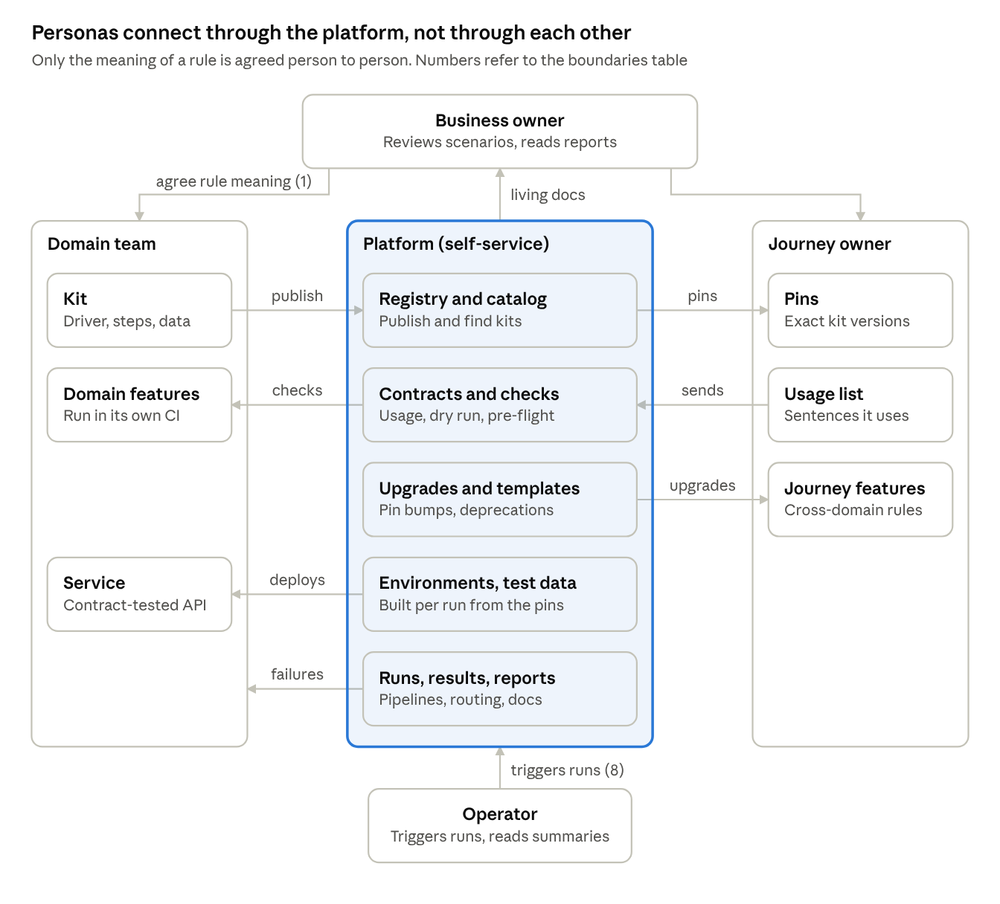

# Journey Testing Platform

> Exported copy. The live, editable version is [here](https://claude.ai/artifact/9Ro74BuHjrqZqK2j626sjc).

Nov 7, 2026 · @Daniel Kolepp

## The platform problem

Journey testing is a platform problem. Many teams depend on each other's work, and the cost of that dependence decides whether testing speeds up or slows down as the organisation grows. The platform makes those dependencies cheap: it connects the people who build testing capabilities with the people who use them, through published artifacts and automated checks instead of meetings.

It works like a marketplace with several sides:

- **Domain teams supply** capabilities: kits that drive their domain.
- **Journey owners use** those kits to test end-to-end outcomes.
- **Operators and business owners use** the results.
- **The platform team runs the marketplace**: catalog, rules, checks, environments, routing. It never makes the goods itself.

Without a platform, three costs grow faster than the work itself:

| Cost | Grows with | Looks like |
| --- | --- | --- |
| Coordination | teams × consumers of each team | "Can I rename this step? Who uses it?" asked in chat |
| Manual validation | journeys × releases | Someone reads journey results before every release |
| External dependencies | journeys × services each one touches | Journeys queue for a shared staging environment or another team's deploy |

The platform's goal: each cost grows only with a team's own work, not with the size of the organisation. Its design rule: replace a conversation with a published artifact, a sign-off with an automated check, and a shared environment with one created per run.

This document assumes service-level contract testing (for example Pact) already exists, and covers journeys written in Gherkin.

## Personas

Six roles take part in journey testing. One person can hold several, but each role owns different things and should need different things.

| Persona | Owns | Publishes | Uses | Must never need |
| --- | --- | --- | --- | --- |
| Business owner (product owner, domain expert) | The business rules and what they mean | Agreed examples, approval of scenarios | Living documentation from test runs | To read code or run tests |
| Domain team (producer) | One domain's service, its API, and its BDD kit: driver, step library, test data, domain features | Versioned kit and its catalog | Service contracts with neighbours; the common kit | To know who uses its steps by asking around, or to run others' journeys before releasing |
| Journey owner (integrator) | One end-to-end outcome, such as checkout | Journey feature files; the list of steps and versions it uses | Domain kits at pinned versions | To understand domain internals, ask permission to upgrade, or wait for an environment someone else controls |
| Platform team (enabler) | The common kit, the runner, CI templates, the registry, environment definitions | Rules and checks | Everyone's usage data | To approve individual changes; it sets rules, not gates |
| Operator (executor) | Running journeys: release manager, CI, on-call | Run results, routed to owners | Journeys, environments, credentials | To read raw logs to find out whose failure it is |
| Reader (living documentation) | Nothing; support, auditors, new joiners | Nothing | Reports of what the system does | To read Gherkin source or code |

The classic BDD "three amigos" (business, development, testing viewpoints) work inside the domain team and the journey owner's work. They are viewpoints, not separate personas here.

The Ansible analogy holds: journey owners are playbook writers, domain teams are role authors, the registry is Galaxy, and the operator is the Controller user.

## Responsibilities

Every part has exactly one owner. The platform team owns the rails: registry, checks, environments, pipelines and routing. Everything that carries domain knowledge belongs to a domain team or a journey owner.

| Part | Business owner | Domain team | Journey owner | Platform team | Operator |
| --- | --- | --- | --- | --- | --- |
| Meaning of business rules | **Owns** | Writes examples | Writes examples | – | – |
| Service and its API contracts | – | **Owns** | – | Provides contract tooling | – |
| Kit: driver, steps, bundled data | – | **Owns** | Uses | Provides template and checks | – |
| Domain feature files | Reviews | **Owns** | – | – | – |
| Journey feature files | Reviews | – | **Owns** | – | – |
| Pins and usage list | – | Checks its releases against them | **Owns** | Collects and serves them | – |
| Common kit (shared kernel) | – | Contributes | Uses | **Owns** | – |
| Registry and catalog | – | Publishes to it | Searches it | **Owns** | – |
| Contract checks (dry run, wiring, usage, pre-flight) | – | Runs them in CI | Runs them in CI | **Owns** | – |
| Environments per run | – | Declares what its kit needs | Declares what its journey needs | **Owns** | Uses |
| Running journeys | – | – | Decides what runs when | **Owns** the pipeline and permissions | Triggers runs |
| Failure triage | – | Fixes its own steps and service | Fixes its own journey | Routes each failure to its owner | Reads the summary |
| Living documentation | Reads | – | – | **Owns** the publishing | Reads |

### What the platform must never own

A platform that takes on domain work becomes the bottleneck it was built to remove. The platform team does not:

- **Write steps, drivers, test data or feature files** for other teams. It provides templates and examples.
- **Approve individual changes.** It sets rules that checks enforce; the checks decide.
- **Triage other teams' failures.** It routes each failure to its owner.
- **Decide what a business rule means.** That stays between business owners and the teams.

## Domain model

The platform sits between every pair of personas. Domain teams publish into it, journey owners pin and report through it, operators run through it, and business owners read what it publishes. People talk to each other directly only to agree what a business rule means.



Read it from the outside in. Each persona owns its own boxes. Each arrow is a published artifact or an automated check provided by one of five platform capabilities, so adding a team adds arrows to the platform, not conversations with every other team.

## Contracts at each boundary

Eight boundaries need a contract. Only one, the meaning of the business rules, needs human judgement; the other seven can be checked by machines on every change.

### Types of contract

| Type | Who defines it | Who checks it, when | Use it for |
| --- | --- | --- | --- |
| Producer-driven (published) | The producer publishes; consumers conform | Consumers, when they upgrade | Interfaces with many consumers: step sentences, driver APIs, parameter types |
| Consumer-driven | Each consumer declares exactly what it uses | The producer, before every release | Stopping a producer from breaking a consumer it didn't know about |
| Shared kernel | Owned jointly; changes need every consumer's build to pass | All consumers' CI | Very small shared pieces: common types, the shared "I should be told" step |
| Declared requirement | The component declares what it needs to run | A pre-flight check before anything runs | Wiring order, environment settings, credentials, test data |
| Agreement | People, in conversation | Review | The meaning of a business rule. Keep it small, and keep it the only human gate |

The terms come from domain-driven design. A domain kit is a *published language*. The common kit is a *shared kernel*. A journey that uses kits as they are is a *conformist*. A journey that wraps a kit in its own steps is building an *anti-corruption layer*, which is a sign the kit is missing something.

### The boundaries

| # | Boundary | What is promised | Type | Checked by, when |
| --- | --- | --- | --- | --- |
| 1 | Business owner ↔ any team | What each scenario means | Agreement | Business owner reviews scenario changes; reads living documentation after runs |
| 2 | Service ↔ service | API requests and responses | Consumer-driven | Your existing contract tests, on every producer build |
| 3 | Domain kit ↔ journey: words | Step sentences, parameter types, and what each step means | Producer-driven + consumer-driven usage list | Producer build checks every consumer's usage list; journey dry run checks undefined or duplicate steps |
| 4 | Domain kit ↔ journey: state | What each kit puts in the shared test state, and what it needs there | Declared requirement | Wiring check: build all drivers in order, run no scenario |
| 5 | Domain kit ↔ its service | The kit drives the service version it was released with | Producer-driven, versioned together | Kit and service ship from the same repo and release; pre-flight compares versions |
| 6 | Domain kit ↔ environment | Endpoints, credentials, feature flags the driver needs | Declared requirement | Pre-flight check at the start of a run |
| 7 | Domain kit ↔ test data | Data is created through the owning domain's steps, never written into another domain's store | Producer-driven | Kit offers "Given" steps for its data; review rule plus database permissions |
| 8 | Journey ↔ operator | Which journeys run where, who may run them, and where results go | Producer-driven (platform) | CI environment rules; results tagged with the owning team |

Boundary 3 is the one service contract tests don't cover. A producer can keep every API contract green while removing a step sentence a journey depends on.

## Contract catalog

Every arrow in the domain model follows a contract, at one of two levels: between personas (carried by the platform), or between a persona and the platform itself. The platform's own contracts matter most, because every team depends on them; they get the same versioning discipline the platform asks of others.

This catalog is illustrative. Field names and formats show the shape of each contract, not a standard.

### Every interaction

| Interaction | From → to | Contract | Level | Type | Checked |
| --- | --- | --- | --- | --- | --- |
| publish | Domain team → platform | Kit manifest (below) | Persona ↔ platform | Producer-driven; format set by the platform | At publish: manifest is valid and matches the code |
| find | Journey owner → platform | Catalog entry, generated from manifests | Persona ↔ platform | Producer-driven | Regenerated on every publish |
| pins | Journey owner → platform | Exact kit versions in the journey's requirements | Persona ↔ persona | Consumer declares | At install: versions exist and fit together |
| sends | Journey owner → platform | Usage list (below) | Persona ↔ persona | Consumer-driven | Before every producer release |
| checks | Platform → domain team | What each check verifies and when it blocks | Persona ↔ platform | Platform-defined, versioned | Changes announced and versioned like code |
| upgrades | Platform → journey owner | Pin-bump pull request, plus a deprecation notice with the new wording | Persona ↔ platform | Platform-defined | By the bot, on each producer release |
| deploys | Platform → domain team's service | Deploy descriptor: version, settings, data setup API | Persona ↔ platform | Declared requirement | Pre-flight, before each run |
| triggers runs | Operator → platform | Run request: journey, environment, tags | Persona ↔ platform | Policy | Permissions in CI |
| failures | Platform → owning team | Failure report (below) | Persona ↔ platform | Platform-defined | Time to notify is measured |
| living docs | Platform → business owner | Report: scenarios, results, when they ran | Persona ↔ platform | Platform-defined | Published on each run |
| agree rule meaning | Business owner ↔ teams | The scenario itself | Persona ↔ persona | Agreement | Review only |

### Kit manifest

The one artifact that makes most other contracts checkable. Every kit release publishes one, and the platform rejects a release whose manifest doesn't match its code.

```yaml
kit: shop-shipping
version: 1.1.0
owner: shipping-team
runner: behave              # the runner adapter this kit provides
service:
  name: shipping
  api_version: 1            # the service API version this kit drives
provides: [shipping]        # what it adds to the shared test state
needs: [outcome]            # what must already be there
environment:
  needs: [SHIPPING_URL]     # settings the driver reads
data:
  bundled: [standard_shipping.json]
steps:
  - text: 'a shipment of {qty:Qty} items should be sent to "{country}"'
    keyword: Then
    since: 1.1.0
  - text: '{qty:Qty} items should be shipped to "{country}"'
    keyword: Then
    deprecated:
      since: 1.1.0
      use: 'a shipment of {qty:Qty} items should be sent to "{country}"'
      removed_in: 2.0.0
```

### Usage list

What a consumer depends on. The journey's CI generates it from a dry run; nobody writes it by hand.

```yaml
consumer: checkout-journey
owner: checkout-team
uses:
  shop-shipping@1.1.0:
    - 'a shipment of {qty:Qty} items should be sent to "{country}"'
    - 'shipping is set up from "{file_name}"'
  shop-payments@1.0.0:
    - 'card "{card}" should be charged {amount:Money}'
```

The producer's release check: every sentence in every usage list for this kit must still exist in the new manifest. A deprecated sentence passes with a warning. A removed one fails the producer's build and names the consumer.

### Failure report

```yaml
journey: checkout-journey
scenario: A discount that drops the order below $50.00 brings shipping back
failed_step: 'the order total should be $57.00'
kit: shop-checkout@1.0.0
step_owner: checkout-team     # from the manifest of the kit that defines the step
category: assertion           # assertion | environment | data | undefined-step
evidence: [run link, logs]
notified: checkout-team
```

The category decides who is notified. Assertion and undefined-step failures go to the step's owner; environment and data failures go to the platform team, which owns environments.

### Versioning the platform's own contracts

- The manifest, usage list and failure report formats each carry a schema version.
- Adding an optional field is a minor change. Removing or renaming a field is a major change.
- The platform keeps accepting the previous major format for a stated period, and its checks warn before they block.

## How a change flows without a meeting

A breaking change to a step sentence takes two releases and no conversation. The producer finds every affected consumer before it ships, and consumers get an upgrade proposed to them by a bot.

Example: the shipping team wants to reword a step that the checkout journey uses.

1. **Publish the new wording, keep the old.** The shipping team adds the new sentence and marks the old one deprecated in a minor release (1.1.0). Its build checks every consumer's usage list; all still resolve, so it ships.
2. **Consumers are told automatically.** The registry shows "deprecated, used by the checkout journey (3 places)". A dependency bot opens a pull request bumping the journey's pin. The journey's dry run lists the deprecated steps with the new wording.
3. **The consumer updates on its own schedule.** The journey owner merges the bump and rewords three lines. Nobody waits for anyone.
4. **Remove when nobody uses it.** When no usage list contains the old sentence, the shipping team removes it in a major release (2.0.0).
5. **If someone still uses it, the producer finds out.** The 2.0.0 build fails and names the consumer. The breakage stops at the producer's build, before any journey goes red.

The only human steps are writing the new wording and merging the bump. The same flow works for driver methods (boundary 4) and for what a kit needs from its environment (boundary 6).

The reverse direction still needs a person. When a journey needs a step that no kit offers, the journey owner opens a request or contributes the step to the domain team's kit. Writing it locally in the journey instead is how anti-corruption layers creep in.

## Friction that remains

Even with every contract in place, ten sources of friction remain. Environments and test data cost the most, because they couple every journey to every service it touches.

| # | Friction | Why it grows with scale | Which cost |
| --- | --- | --- | --- |
| F1 | **Shared environments.** Journeys queue for staging, break on other teams' deploys, and fight over data | Every new journey and service adds contention for the same place | External dependencies |
| F2 | **Test data.** Scenarios depend on fixtures that someone else changes or deletes | Shared data sets grow and drift; nobody owns all of them | External dependencies |
| F3 | **Version skew.** The journey pins kit 1.1 but the environment runs a newer service | More teams deploying independently means more combinations | Manual validation |
| F4 | **Step vocabulary.** Sentences collide, near-duplicates appear ("my basket" vs "my cart"), and meaning drifts | Gherkin has no namespaces; every new author can collide with every other | Coordination |
| F5 | **Hidden shared state.** One kit relies on another having set something up | Dependencies between kits multiply and nobody has them all in mind | Coordination |
| F6 | **Failure triage.** A red journey; whose bug is it? | Each journey touches more teams; the journey owner becomes everyone's triage desk | Coordination, manual validation |
| F7 | **Flaky journeys.** Timing, data or environment noise | People stop trusting red, then re-run and read results by hand | Manual validation |
| F8 | **Journey sprawl.** Journeys repeat what domain features already test | "Just one more scenario" is cheap to add and never removed; run time grows | All three |
| F9 | **Upgrade lag.** Consumers stay on old kits; producers carry deprecated steps for ever | Each producer waits for its slowest consumer | Coordination |
| F10 | **Specs stop being specs.** Business owners stop reading; Gherkin becomes test scripts | Volume outgrows anyone's reading time | Coordination (rules drift silently) |

Two gaps sit between teams rather than inside one. Cross-domain rules (free shipping is judged after the discount) belong to no domain, so a named journey owner must own them. And each extra language or runner (Python with behave, Go with godog) multiplies every kit by the number of runners.

## Platform capabilities

Ten capabilities remove the friction listed above. Each has a first version that costs hours to days and reuses tools teams already have: CI, a package index, a dependency bot and CODEOWNERS. Build the first version everywhere before improving any one of them.

| Capability | For | Removes | First version (cheap) | Later |
| --- | --- | --- | --- | --- |
| **Registry and catalog** | Domain teams publish; journey owners find steps | F4; "does a step for this exist?" | Package index, plus a catalog generated from step descriptions on every release | Searchable portal showing each sentence's users |
| **Usage contracts** | Domain teams learn who uses what; journeys are protected | Boundary 3; F9 | Journey CI exports the sentences it uses as JSON to a shared repo; producer CI checks them before releasing | Inside your existing contract broker, with a "can I release?" gate |
| **Contract checks** | Journey owners and domain teams | F3, F4, F5 | A CI template step: dry run (undefined or duplicate steps), wiring check (provides and needs), pre-flight (environment, versions) | The same checks in editors, as people type |
| **Golden-path templates** | New domain teams and journey owners | Onboarding by conversation | Repo templates for a kit and for a journey, with CI already wired | A command that scaffolds them |
| **Upgrade automation** | Journey owners; domain teams retiring steps | F9 | A dependency bot opens pin-bump pull requests; deprecation warnings give the new wording | Automatic rewording of deprecated sentences in feature files |
| **Test data by domain** | Everyone running journeys | F2 | Each kit creates its own data through its API, with unique ids per scenario | Data sets defined per journey and created on demand |
| **Environments per run** | Journey owners, operators | F1, F3 | Unique data lets journeys share staging safely | An environment built per run from the pins, with services outside the journey stubbed from contract-test fixtures |
| **Run orchestration** | Operators | Boundary 8 | CI pipelines with protected environments; tags choose what runs | A self-service run portal with job templates, like Ansible Controller |
| **Results routing** | Domain teams, journey owners, operators | F6, F7 | Failure reports name the team that owns the failing step; quarantine with an expiry date | Flakiness dashboard and automatic quarantine |
| **Living documentation** | Business owners, readers | F10 | Reports published from every run; business owner as required reviewer on feature folders | A documentation site per domain, linked to the catalog |

Two policies need no tooling at all. A journey scenario must name a cross-domain rule or a failure that must not half-happen, or it moves to a domain feature (F8). And all journeys use one runner, so each kit needs only one adapter.

## How the platform engages

The platform is a product used through self-service. Talking to the platform team should be the exception, and every repeated conversation is a missing capability.

Three ways of working, taken from *Team Topologies*:

| Mode | When | Ends when |
| --- | --- | --- |
| **As a service** (default) | Every day: teams use templates, the registry, checks and pipelines without asking anyone | Never; this is the normal state |
| **Enabling** | A new domain team or journey owner joins, or a team adopts a new capability | The team works on its own, in weeks, not months |
| **Collaboration** | Building a new capability with one pilot team | The capability is self-service for everyone |

Four rules keep the platform from becoming a bottleneck:

1. **Rules, not gates.** The platform publishes rules (step phrasing, versioning, the journey rule) and enforces them with checks. No person approves a change.
2. **A paved road, not the only road.** Teams may leave the templates, but they then own what they built.
3. **Contributions welcome.** Any team can change the common kit by pull request. The check is that every consumer's build still passes, not a platform review.
4. **Measured friction sets the roadmap.** The signals below decide what the platform builds next, not requests from the loudest team.

## Measuring the platform

The platform works if the three costs stay flat as teams and journeys are added. Track one or two signals per cost, plus adoption. Targets are open: set them once you have a baseline.

| Cost | Signal | Healthy trend |
| --- | --- | --- |
| Coordination | Conversations needed to release a kit change (sample a few releases) | Near zero |
| Coordination | Time from a deprecation to the last consumer upgrading | Falling |
| Manual validation | Releases that wait for a person to read journey results | Zero |
| Manual validation | Time from a red journey to the owning team being notified | Minutes |
| Manual validation | Scenarios in quarantine past their expiry date | Zero |
| External dependencies | Time journeys wait for an environment | Near zero |
| External dependencies | Journey failures caused by environment or data rather than code | Falling |
| External dependencies | Total journey run time compared with the number of journeys | Grows no faster |
| Adoption | Time for a new team to publish its first kit, or a journey owner to run a first journey | Falling |
| Adoption | Share of journeys on the paved road: templates, pins, usage list exported | Rising |

Open question: which of these can be collected automatically from CI today, and which need a periodic sample?

## Rules of thumb and warning signs

Six rules keep the costs flat as teams are added:

1. **Every boundary has an artifact and a check.** People review only what needs judgement: what a business rule means.
2. **The producer finds the break, not the consumer.** A breaking change fails the producer's build, naming who would break.
3. **Journeys are few.** Domain behaviour lives in domain features; journeys hold cross-domain rules and failures that must not half-happen.
4. **Pin versions; let a bot upgrade them.** Floating versions turn every release into a surprise for someone else.
5. **Each domain creates its own data.** Through its own steps and API, never by writing into another domain's store.
6. **A red journey names an owner within minutes.** Without that, the journey owner becomes everyone's triage desk.

Watch for these signs that a cost is growing:

| You notice | It means | Fix |
| --- | --- | --- |
| "Who uses this step?" asked in chat | No usage contract at boundary 3 | Usage lists checked by producers |
| A release waits for someone to read journey results | Manual validation has crept in | Owner routing (F6), quarantine (F7) |
| Journeys queue for staging | External dependency on a shared environment | Unique data per run, then environments per run (F1) |
| Journey owners write steps that reach into a domain | A kit is missing a capability | Contribute the step to the domain's kit |
| Journey run time grows faster than the number of journeys | Journeys repeat domain tests | The journey rule and a time budget (F8) |
| Deprecated steps never reach zero use | No upgrade automation | Dependency bot (F9) |
| Business owners haven't opened the reports in months | Specs are becoming test scripts | Living documentation and review rules (F10) |

## Glossary

| Term | Meaning |
| --- | --- |
| Journey | An end-to-end scenario across several domains, owned by a journey owner. Like an Ansible playbook |
| Domain feature | A feature file testing one domain's own rules, owned by that domain team |
| Kit (BDD kit) | What a domain team publishes for others: driver, step library, bundled test data, catalog. Like an Ansible role |
| Driver | Code that performs business actions on a domain ("charge a card"), hiding how |
| Step library | Step definitions that map Gherkin sentences to driver calls |
| Step vocabulary | The set of sentences a kit offers; its public API |
| Shared test state | The object all steps in a scenario share (behave's `context`, pytest fixtures) |
| Pin | The exact kit version a journey uses, listed in its requirements file |
| Registry | Where kits are published and found: a package index plus the catalog. Like Ansible Galaxy |
| Usage list | The sentences a consumer uses, published so producers can check them before releasing |
| Pre-flight check | A check run before any scenario: wiring, environment settings, versions |
| Living documentation | Readable reports generated from test runs, for people who don't read Gherkin source |
| Provider state | Contract-testing term for the setup a test needs ("a card with a $100 limit"); close to a Gherkin Given |
| Platform | Self-service capabilities that let personas publish, find, check, run and read each other's work without coordinating directly |
| Capability | One service the platform offers, such as the registry or results routing |
| Paved road | The supported way of doing something (templates, checks, pipelines). Teams may leave it, but then own what they build |
| Rules, not gates | Policies enforced by automated checks instead of by a person approving each change |
